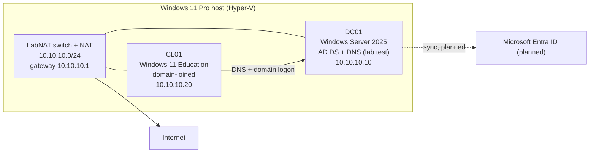

# Hybrid Identity Lab (AD → Entra ID)

A local Hyper-V lab where I build and automate an on-premises Active Directory, which I will later connect to Microsoft Entra ID. The lab focuses on the user lifecycle (onboarding and offboarding), least-privilege delegation and repeatable PowerShell automation.

> **Status:** Phase 1 (on-prem AD + automation) is complete, and a Windows 11 client is joined to the domain. Account lockout and Windows LAPS are in place and tested. Next: Entra ID sync. See [Roadmap](#roadmap).

## What this lab demonstrates

- Building an AD DS forest from scratch on Windows Server 2025, including DNS, networking and health checks
- Joiner/leaver automation in PowerShell: CSV → AD users, and offboarding by EmployeeId
- Idempotent scripts with `-WhatIf` support, so they are safe to run again
- Least-privilege Help Desk delegation (password reset and unlock only)
- Joining a Windows 11 client (Secure Boot + vTPM) to the domain, directly into the right OU
- Domain account lockout policy, tested from the client and traced with event 4740
- Windows LAPS: the local admin password is a random passphrase, rotated every 30 days and stored encrypted in AD
- User reporting to CSV for audits
- Keeping secrets out of Git

## Architecture



## Lab environment

| Component | Details |
|---|---|
| Host | Windows 11 Pro, 16 GB RAM, Hyper-V |
| Network | Internal switch `LabNAT` + NAT, `10.10.10.0/24`, static IPs (no DHCP) |
| DC01 | Windows Server 2025 Standard (Desktop Experience), Gen 2, 2 vCPU, 1–4 GB dynamic RAM, `10.10.10.10` |
| CL01 | Windows 11 Education 25H2, Gen 2 with Secure Boot + vTPM, 2 vCPU, 2–4 GB dynamic RAM, `10.10.10.20`, DNS `10.10.10.10`, in `OU=Workstations` |
| Domain | `lab.test` (NetBIOS `LAB`), functional level Windows Server 2025 |
| DNS | The DC points to itself (`127.0.0.1`); forwarder `1.1.1.1` |

`.test` is reserved for testing and never resolves on the internet. In production I would use a subdomain of a domain the organisation owns (for example `ad.example.com`).

## OU structure

```
lab.test
└── LAB
    ├── Users
    │   ├── HR
    │   ├── IT
    │   └── Sales
    ├── Computers
    │   ├── Workstations
    │   └── Servers
    ├── Groups
    ├── ServiceAccounts
    └── Disabled
```

The top level is split by object type, so Group Policy, delegation and the Entra sync scope can target users and computers separately. Departments exist only under `Users`.

## Scripts

| Script | What it does |
|---|---|
| `scripts/New-LabOU.ps1` | Creates the OU structure |
| `scripts/New-LabGroups.ps1` | Creates the department groups `SG-Dept-HR/IT/Sales` and the role group `SG-Role-HelpDesk` (global security groups) |
| `scripts/New-LabUsers.ps1` | Onboarding from `data/new-users.csv`. Matches users by EmployeeId, converts ä/ö to ASCII, keeps usernames within 20 characters with a number suffix if taken, sets a random 16-character initial password with change at first logon, and adds the user to the department OU and group |
| `scripts/Disable-LabUser.ps1` | Offboarding by EmployeeId: disables the account, stamps the description, removes groups and moves the account to `OU=Disabled`. Supports `-WhatIf` |
| `scripts/Get-LabUserReport.ps1` | User report (status, OU, groups, last logon, password last set), returned as objects. I export it on the host to a CSV outside the repo, with `;` as the delimiter for Finnish Excel |
| `scripts/Grant-LabHelpDeskRights.ps1` | Delegates Help Desk rights to `SG-Role-HelpDesk`. Supports `-WhatIf` |
| `scripts/Enable-LabLaps.ps1` | Windows LAPS: extends the schema if needed, lets workstations write their own password, and creates and links the GPO `LAB-Workstations-LAPS` to `OU=Workstations`. Supports `-WhatIf` |

`data/new-users.csv` contains 7 fictional users. It includes Finnish characters and two people named Mikko Virtanen on purpose, to test name collisions.

The scripts use only ASCII characters, because Windows PowerShell 5.1 reads UTF-8 files without a BOM as Windows-1252.

## How to run

The scripts stay on the host and run inside the VM over **PowerShell Direct** (`Invoke-Command -VMName`), which needs no network connection. Run these from an elevated PowerShell on the host:

```powershell
$cred = Get-Credential LAB\Administrator
$repo = 'C:\path\to\hybrid-identity-lab'

Invoke-Command -VMName DC01 -Credential $cred -FilePath "$repo\scripts\New-LabOU.ps1"
Invoke-Command -VMName DC01 -Credential $cred -FilePath "$repo\scripts\New-LabGroups.ps1"

$users = Import-Csv "$repo\data\new-users.csv" -Encoding UTF8
Invoke-Command -VMName DC01 -Credential $cred -FilePath "$repo\scripts\New-LabUsers.ps1" -ArgumentList (,$users)

Invoke-Command -VMName DC01 -Credential $cred -FilePath "$repo\scripts\Grant-LabHelpDeskRights.ps1"
Invoke-Command -VMName DC01 -Credential $cred -FilePath "$repo\scripts\Enable-LabLaps.ps1"
```

`-FilePath` passes only positional arguments. For named parameters such as `-WhatIf`:

```powershell
$code = Get-Content "$repo\scripts\Disable-LabUser.ps1" -Raw
Invoke-Command -VMName DC01 -Credential $cred -ScriptBlock {
    & ([scriptblock]::Create($using:code)) -EmployeeId 'E1007' -WhatIf
}
```

Account lockout is set in the Group Policy Management Console (Default Domain Policy → Computer Configuration → Policies → Windows Settings → Security Settings → Account Policies → Account Lockout Policy). To verify:

```powershell
Invoke-Command -VMName DC01 -Credential $cred -ScriptBlock {
    Get-ADDefaultDomainPasswordPolicy | Format-List LockoutThreshold, LockoutDuration, LockoutObservationWindow
}
```

Reading the LAPS password into a credential without showing it. A SecureString does not cross PowerShell Direct, so the text is converted on the host right away:

```powershell
$lapsPw = ConvertTo-SecureString -AsPlainText -Force (Invoke-Command -VMName DC01 -Credential $cred -ScriptBlock {
    (Get-LapsADPassword -Identity CL01 -AsPlainText).Password })
$lapsCred = [pscredential]::new('CL01\WLapsAdmin', $lapsPw)
Invoke-Command -VMName CL01 -Credential $lapsCred -ScriptBlock { hostname }
```

Joining the client (run on CL01 as the local admin). One command sets the name, joins the domain and places the computer object in the right OU:

```powershell
Add-Computer -DomainName lab.test -NewName CL01 `
    -OUPath 'OU=Workstations,OU=Computers,OU=LAB,DC=lab,DC=test' `
    -Credential LAB\Administrator -Restart
```

The report script returns objects, so the CSV is written on the host. `-Encoding UTF8` keeps ä/ö readable in Excel:

```powershell
$out = 'C:\path\to\lab-reports'
$report = Invoke-Command -VMName DC01 -Credential $cred -FilePath "$repo\scripts\Get-LabUserReport.ps1"
$report | Select-Object * -ExcludeProperty PSComputerName, RunspaceId, PSShowComputerName |
    Export-Csv "$out\users-$(Get-Date -Format 'yyyy-MM-dd').csv" -Delimiter ';' -Encoding UTF8 -NoTypeInformation
```

## Design decisions

- **EmployeeId is the identity key.** Names are neither unique nor stable, and the username is only created by the script. This is the same idea as the source anchor in Entra sync.
- **Idempotent scripts.** Each script checks the current state and performs only the missing steps. It returns objects with a status (`Created/Exists/Failed`, `Offboarded/AlreadyDone/NotFound/WhatIf/Failed`) instead of plain text.
- **`-WhatIf` everywhere it matters.** `SupportsShouldProcess` uses the same mechanism as Microsoft's own cmdlets.
- **Safe offboarding scope.** The search is limited to `OU=LAB`, so built-in accounts cannot be hit by mistake. If the CN collides in `OU=Disabled`, the account is renamed to `Name (EmployeeId)` before the move.
- **Rights go to groups, not users.** When a role changes or someone leaves, removing them from the group removes all of its rights at once.
- **Help Desk delegation scope.** `SG-Role-HelpDesk` gets Reset Password plus read/write on `pwdLastSet` and `lockoutTime` only for user objects under `OU=Users` (inherited by descendants). `OU=Disabled` is a sibling of `OU=Users`, so the Help Desk cannot reset passwords of accounts that have left, and Help Desk members' own accounts must not live under `OU=Users`.
- **Lockout lives in the Default Domain Policy.** Password and lockout settings for domain accounts apply only from a GPO linked to the domain root. Linked to an OU, they would affect only the computers' local accounts. The values follow the Microsoft security baseline: 10 attempts, a 15-minute lockout and a 15-minute counter reset. Exceptions, such as stricter rules for admins, belong in Fine-Grained Password Policies.
- **LAPS manages its own account.** The GPO covers the whole `OU=Workstations`, so a per-machine account like `cl01admin` would not scale. Automatic account management (Windows 11 24H2 / Server 2025) creates `WLapsAdmin` on every workstation. Passwords are passphrases, which are easier to type in a console. The manual `cl01admin` account is disabled.
- **Secrets stay out of Git.** Initial passwords and reports are stored outside the repo. Credentials are never written into the scripts.
- **Lab-only shortcuts.** Restoring a DC from a checkpoint is safe only because this lab has a single DC. Production would use the AD Recycle Bin and backups.

## Tested

- **Onboarding:** 7 users created. The second Mikko Virtanen became `mikko.virtanen2`.
- **Offboarding:** every result branch was tested, including the CN collision when both Mikko Virtanens were moved to `OU=Disabled`.
- **Delegation:** tested as a Help Desk test account using `-Credential`. Unlock and reset worked under `OU=Users`. Reset in `OU=Disabled` and editing the description were denied. The test account was removed afterwards.
- **Client join:** CL01 joined with `Add-Computer -OUPath`, so it landed directly in `OU=Workstations` instead of the default `CN=Computers` container, which is not an OU and cannot have GPOs linked.
- **Domain logon:** `LAB\aino.makinen` signed in on CL01 after the forced first-logon password change. `PasswordLastSet` and `LastLogonDate` were populated in AD.
- **Account lockout:** 10 wrong passwords for `aino.makinen` on CL01 locked the account, and the correct password on the 11th attempt was rejected. DC01 logged event 4740 with `Caller Computer Name: CL01`. After 15 minutes `LockedOut` returned to `False` on its own, and the next successful logon reset `BadLogonCount` and `lockoutTime` to 0.
- **Windows LAPS:** the script was run with `-WhatIf` first, then for real, then again (every step returned `Exists`). CL01 created `WLapsAdmin`, and `Get-LapsADPassword` showed `Source: EncryptedPassword` and an expiry 30 days ahead. Interactive logon with `.\WLapsAdmin` worked, the account is in Administrators, and after disabling `cl01admin` its credential was rejected.
- **DC health:** DNS resolution, SYSVOL/NETLOGON shares and DFSR event 4602. The network profile was fixed from `Public` to `DomainAuthenticated` by delaying the start of the NLA service.

## Lessons learned

- A DC must use itself for DNS. With `1.1.1.1` it cannot find its own SRV records, and logons, domain joins and GPOs stop working.
- A password reset also clears "change password at next logon", so the Help Desk process sets it again.
- An unused account that still has its initial password is a takeover risk. Better options are automatic disabling after X days, or a Temporary Access Pass.
- A client must also use the DC for DNS. With a public resolver it cannot find `lab.test`, and the join fails with "domain controller could not be contacted".
- Hyper-V Enhanced Session is RDP with Network Level Authentication, so a "change password at next logon" password cannot be changed there. Basic Session works. Remote workers on RDP hit the same problem, which SSPR with password writeback solves.
- "The password does not meet the length, complexity, or history requirement" covers three causes. An admin reset skips the history check, but a user's own change does not, so the same password can pass one and fail the other.
- The default domain policy had no account lockout (`LockoutThreshold 0`). My Sentinel honeypot showed why that matters, so lockout was the first GPO.
- Lockout slows guessing but does not stop it. With a 15-minute reset, an attacker can try about 36 passwords an hour per account without a lockout, so monitoring (event 4740, low-and-slow detection) is still needed.
- `lockoutTime` stays set after the lockout expires, because AD calculates `LockedOut` from the clock. It is stored as FILETIME (`[datetime]::FromFileTime()` converts it).
- `Get-ADUser` returns only default properties. A field missing from `-Properties` shows up empty without an error.
- A downloaded script carries the Mark of the Web, so `RemoteSigned` blocks it. `Unblock-File` removes the mark. Reading the same file with `Get-Content -Raw` ran it anyway, which shows that execution policy is not a security boundary.
- Unlike lockout, LAPS settings are registry-based, so `Set-GPRegistryValue` can script the whole GPO. Security settings such as lockout need GPMC or an imported GPO backup.
- After the LAPS password is used, it is reset within 24 hours (`PostAuthenticationActions`), so a password given to the Help Desk does not stay valid.
- In a hybrid setup, disabling an account in AD reaches Entra only after the next sync, so offboarding should also revoke the user's Entra sessions.

## Roadmap

- [x] AD DS + DNS on Windows Server 2025
- [x] OU structure, groups, onboarding, offboarding, reporting, Help Desk delegation
- [x] Windows 11 client `CL01` joined to the domain, domain logon tested
- [x] Account lockout in the Default Domain Policy, tested from CL01
- [x] Windows LAPS with automatic account management, `cl01admin` disabled
- [ ] More workstation GPOs in `OU=Workstations`
- [ ] Entra ID: routable UPN suffix, then sync (Cloud Sync vs Connect Sync) scoped to `OU=Users` and `OU=Groups`
- [ ] MFA, Conditional Access and a Temporary Access Pass for new users
- [ ] Entra sign-in logs to Microsoft Sentinel with a detection rule (links to my [Sentinel honeypot](https://github.com/Tuomas404/azure-sentinel-honeypot))
- [ ] Hybrid offboarding: revoke Entra sessions
- [ ] Pester tests + PSScriptAnalyzer in GitHub Actions

## Related

- [Azure Sentinel honeypot](https://github.com/Tuomas404/azure-sentinel-honeypot)
- [Portfolio](https://tuomas404.github.io)
- [LinkedIn](https://www.linkedin.com/in/tuomas404/)
